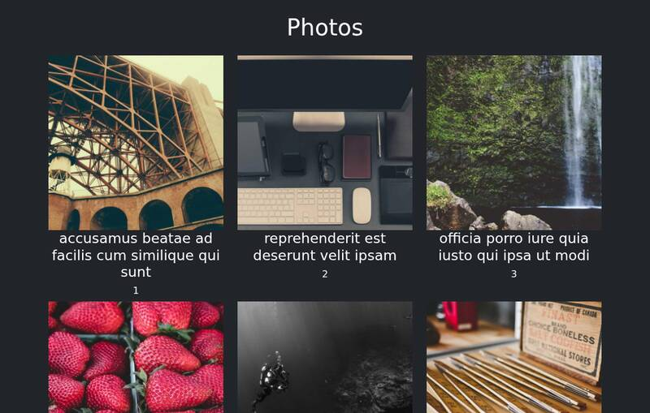
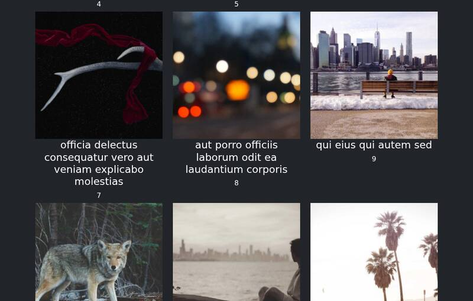

# JavaScript Task 2 (API)

In this task I get data from an API using XMLHttpRequest and show it on the page with Bootstrap cards.

- API used: https://jsonplaceholder.typicode.com/photos
- The request is done in `main.js` with `XMLHttpRequest`
- When the request is ready (readyState 4 and status 200) I use `JSON.parse` to convert the response to an array
- A `for` loop makes one Bootstrap card for each photo (image, title and id)
- All the cards are added to the page with `innerHTML`

## Files

- `index.html`
- `main.js`

## How to run

Open `index.html` in the browser (you need internet for the API and Bootstrap).

## Screenshots

The top of the page:

Scrolling down:

